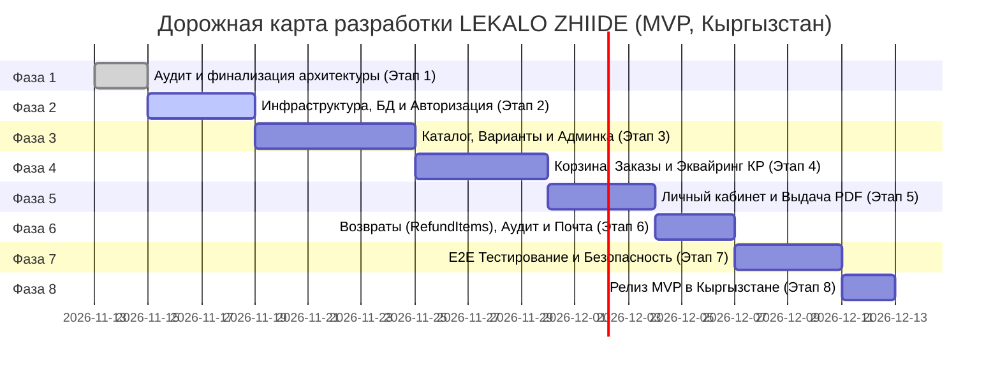

# LEKALO ZHIIDE — ПЛАН И ЭТАПЫ РАЗРАБОТКИ (DEVELOPMENT ROADMAP)

**Версия документа:** 1.2 (Финализирована по итогам аудита TASK-001.3)  
**Статус:** Черновик для согласования с владельцем проекта (Адилет)  
**Дата обновления:** 13 ноября 2026 г.  
**Целевой рынок:** Кыргызская Республика (Кыргызстан)  

---

## 1. Обзор фаз реализации проекта

План разбит на 8 последовательных этапов. Переход к следующему этапу возможен только при соблюдении критериев готовности (Definition of Done — DoD).

---

## 2. Подробное описание этапов

### Этап 1: Архитектурный аудит и финализация ТЗ (Текущий этап)
- **Задачи:**
  - Полный независимый аудит всех 7 документов с учетом специфики Кыргызстана (KGS, платежи, Закон КР № 58).
  - Устранение архитектурных пробелов (добавление `RefundItems`, уточнение прав `PurchaseEntitlements`).
  - Согласование стека (Вариант А vs Вариант Б) и открытых вопросов с Адилетом.
- **DoD (Definition of Done):** Все 7 документов обновлены и согласованы, отчет по аудиту `TASK_001_3_AUDIT_REPORT.md` подготовлен, получено подтверждение владельца проекта.

---

### Этап 2: Базовая инфраструктура, База данных и Авторизация
- **Задачи:**
  - Инициализация репозитория (монорепозиторий pnpm workspace / Turborepo).
  - Настройка `docker-compose.yml` (PostgreSQL 16, Redis 7, MinIO для локальной эмуляции S3).
  - Написание схемы `schema.prisma`, генерация первичных миграций для всех 22 сущностей (с типом `NUMERIC(12,2)`).
  - Создание сидов для базовых справочников: `Sizes`, `Heights`, `Formats`.
  - Модуль `Auth`: регистрация, вход, Argon2id, управление сессиями `UserSessions`, cookies `SameSite=Lax`, RBAC Guards.
- **DoD:**
  - Контейнеры поднимаются одной командой `docker compose up -d`.
  - Проходят Unit-тесты сервиса авторизации (покрытие > 85%).
  - Токены валидируются, сессии корректно отзываются.

---

### Этап 3: Каталог товаров, Конструктор вариантов и Админ-панель
- **Задачи:**
  - Модуль `Catalog`: CRUD категорий, товаров, галерей `ProductImages`.
  - Матричный генератор вариантов `POST /admin/products/:id/variants/batch`.
  - Интеграция с S3: загрузка медиафайлов и генерация Presigned PUT URL для PDF выкроек и инструкций.
  - Витрина каталога на Next.js (App Router, Server Components, фильтры, отображение цен в KGS).
  - Интерактивная карточка товара с переключением размеров/ростовок.
  - Админ-панель контент-менеджера для загрузки моделей и PDF-файлов.
- **DoD:**
  - Контент-менеджер может создать модель, сгенерировать матрицу вариантов и загрузить PDF-файлы.
  - Публичный каталог корректно фильтрует товары и быстро отдает страницы (LCP < 1.5 с).

---

### Этап 4: Корзина, Оформление заказа и Эквайринг Кыргызстана
- **Задачи:**
  - Модуль корзины: гостевые сессии (`guest_token`), валидация цен, слияние корзин при входе.
  - Модуль чекаута: создание заказа `Orders`, фиксация неизменяемого слепка `OrderItems.product_snapshot`.
  - Реализация интерфейса `IPaymentGateway` и адаптера выбранного эквайринга Кыргызстана (Freedom Pay KG / MBANK / DemirBank).
  - Обработка входящих вебхуков с логированием в `PaymentWebhookEvents` и проверкой подписи.
  - Повторная попытка оплаты (`retry-payment`) без дублирования заказа.
  - Планировщик сверки зависших платежей (Reconciliation Cron).
- **DoD:**
  - Заказ корректно создается в сомах (KGS), перенаправляет на страницу банка.
  - Тестовый вебхук переводит заказ в `PAID` строго один раз (идемпотентность подтверждена).
  - Повторный вызов вебхука не производит повторных начислений прав.

---

### Этап 5: Личный кабинет, Цифровые права и Защищенная выдача файлов
- **Задачи:**
  - Автоматическая генерация `PurchaseEntitlements` (1 к 1 с `OrderItem`, связь с `variant_id`).
  - Личный кабинет покупателя: раздел «Мои выкройки» с фильтрацией по покупкам.
  - Генерация безопасных временных ссылок (Presigned GET URLs, TTL 10 мин, `Content-Disposition: attachment`).
  - Журналирование скачиваний в `DownloadLogs` (IP, User-Agent, версия файла).
  - Модуль версионирования файлов (`FileVersions`): отдача актуальной версии по умолчанию и доступ к архивным ревизиям.
  - Выдача общих инструкций по пошиву модели (`ProductInstructions`).
- **DoD:**
  - Покупатель видит купленные выкройки сразу после успешной оплаты.
  - Неавторизованный пользователь или покупатель без прав получает отказ `403 Forbidden`.
  - Ссылка на скачивание инвалидируется через 10 минут.

---

### Этап 6: Возвраты средств (RefundItems), Аудит и Нотификации
- **Задачи:**
  - Модуль возвратов `Refunds` и `RefundItems`: реализация полного и частичного возвратов через API шлюза.
  - Точечный отзыв прав: перевод в статус `REVOKED` строго для возвращенных позиций.
  - Протоколирование всех действий персонала в `AuditLogs`.
  - Воркер BullMQ и транзакционная почта:
    - Отправка квитанции об оплате и ссылок на вход.
    - Уведомление о возврате средств.
    - Уведомление об обновлении версии выкройки.
- **DoD:**
  - При частичном возврате доступ отзывается только к выбранному товару, остальные остаются активными.
  - Любое действие администратора фиксируется в `AuditLogs`.

---

### Этап 7: Сквозное тестирование, Нагрузочные испытания и Безопасность
- **Задачи:**
  - E2E-тесты на Playwright:
    - Гость добавляет выкройку → чекаут → тестовая оплата в KGS → вход в ЛК → скачивание PDF.
    - Сценарий отказа в оплате и успешного ретрая.
    - Сценарий частичного возврата.
  - Нагрузочное тестирование каталога и корзины с помощью **k6** (150 RPS без ошибок).
  - Аудит безопасности: заголовки CSP, CORS, проверка защищенности приватного S3 бакета.
- **DoD:**
  - 100% прохождение E2E-тестов.
  - Тест на проникновение подтверждает недоступность приватного S3 бакета без presigned URL.

---

### Этап 8: Подготовка инфраструктуры и Запуск (MVP Кыргызстан)
- **Задачи:**
  - Настройка боевого сервера (Nginx, Docker Compose, SSL Let's Encrypt).
  - Настройка доменных записей и почтовых подписей (SPF, DKIM, DMARC).
  - Настройка автоматического резервного копирования PostgreSQL (pg_dump по расписанию).
  - Подключение боевых ключей эквайринга Кыргызстана.
  - Smoke-тестирование реальным платежом (10 сомов).
  - Открытие витрины для пользователей.
- **DoD:** Магазин функционирует на боевом домене, принимает платежи в сомах и выдает выкройки.
